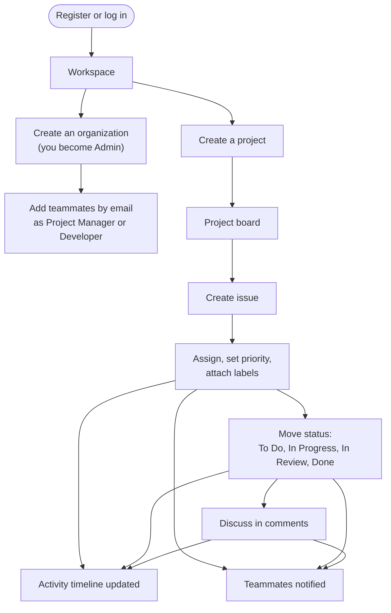
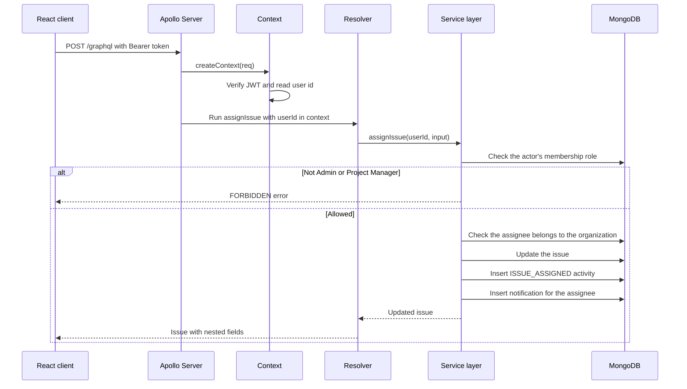
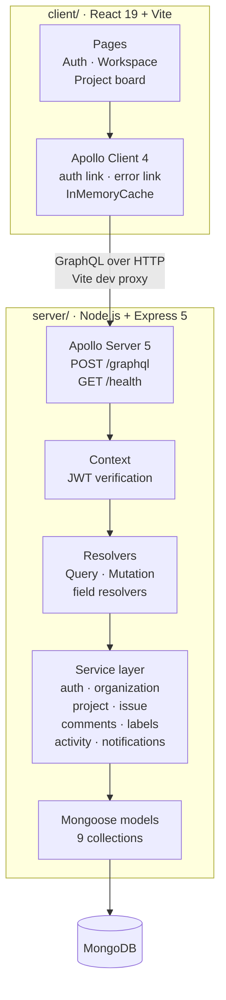
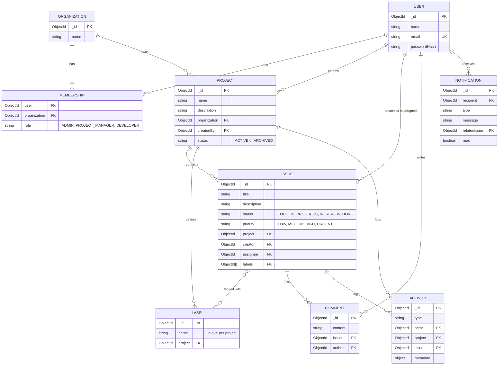

<div align="center">

<h1>DevHub</h1>

<p><b>A developer collaboration and project management platform</b></p>

<p><i>Organizations, projects, issues, comments and labels, with role-based access, activity feeds and notifications, powered by GraphQL.</i></p>


**Create an organization, invite your team with roles, run projects, track issues from To Do to Done,<br>and stay in the loop with an activity timeline and in-app notifications.**

[Features](#features) · [Roles](#roles-and-permissions) · [Architecture](#architecture) · [Getting Started](#getting-started) · [GraphQL API](#graphql-api) · [Testing](#testing) · [Roadmap](#roadmap)

</div>

---

## Overview

**DevHub** is a full-stack project management tool for software teams, in the spirit of Jira and Linear. It's a JavaScript monorepo with two workspaces:

- **`server/`** is a **GraphQL API** built with **Apollo Server 5** on **Express 5**. Business logic lives in a dedicated service layer that handles authentication, role checks, validation, activity logging and notifications. Data is stored in **MongoDB** through **Mongoose**.
- **`client/`** is a **React 19** single-page app built with **Vite**. It uses **Apollo Client 4** for data fetching and caching and **React Router 7** for navigation.

A user creates an **organization** and becomes its admin. Admins add teammates by email as **project managers** or **developers**. Inside each project, the team creates **issues**, assigns them, moves them through a four-stage workflow, discusses them in **comments** and tags them with **labels**. Every change is recorded in an **activity feed**, and the people involved get **notifications**.

## Features

| Feature | How it works |
|---|---|
| **JWT authentication** | Passwords are hashed with bcrypt (12 rounds). Login returns an HS256 JWT, which the client sends as a `Bearer` token. The server verifies it once per request and puts the user id on the GraphQL context. |
| **Organizations and teams** | Creating an organization makes you its admin. Admins invite existing users by email with a role. |
| **Role-based access control** | Three roles (Admin, Project Manager, Developer) are enforced in the service layer on every query and mutation. See [Roles and permissions](#roles-and-permissions). |
| **Projects** | Create, rename and describe projects, then archive or reactivate them. Projects are listed per organization or across all your organizations. |
| **Issue tracking** | Issues have a title, description, status (`TODO`, `IN_PROGRESS`, `IN_REVIEW`, `DONE`), priority (`LOW` to `URGENT`) and an optional assignee who must belong to the organization. |
| **Filtering and pagination** | Filter issues by status, priority or assignee, with `limit` and `offset` pagination backed by compound MongoDB indexes. |
| **Comments** | Discuss issues in threaded comments. Only the author or a manager can edit a comment. |
| **Labels** | Project-scoped labels with unique names, which can be attached to and removed from issues. |
| **Activity timeline** | Creating issues, assigning them, changing status or priority, commenting and labelling are all logged per issue and per project. |
| **Notifications** | Users are notified when they're assigned an issue, when an issue they're involved in is updated, and when someone comments on it. Notifications can be marked as read individually or all at once. |
| **Session handling** | The client attaches the token with an Apollo link. An error link logs the user out automatically when the server reports `UNAUTHENTICATED`. |
| **Health check** | `GET /health` reports whether the server is connected to MongoDB, for uptime monitoring. |
| **Integration tests** | Six test suites with 57 cases use Node's built-in test runner against a real MongoDB database. |

## Roles and Permissions

| Action | Admin | Project Manager | Developer |
|---|:---:|:---:|:---:|
| View organization, projects, issues, comments and activity | Yes | Yes | Yes |
| Create and update issues | Yes | Yes | Yes |
| Comment on issues and edit your own comments | Yes | Yes | Yes |
| Create, update, archive and reactivate projects | Yes | Yes | |
| Assign and unassign issues | Yes | Yes | |
| Create labels and attach or remove them | Yes | Yes | |
| Edit other people's comments | Yes | Yes | |
| Add members to the organization | Yes | | |

The user who creates an organization becomes its **Admin**. Members are added as **Project Managers** or **Developers**.

## How It Works

### User journey



### Life of a GraphQL request



## Architecture



**Design highlights**

- **Thin resolvers, rich services.** Resolvers only translate GraphQL calls. All validation, permission checks and side effects live in testable service functions.
- **Authorization at the data layer.** Every service call checks that the user belongs to the relevant organization and has the required role before reading or writing, so no endpoint can skip a permission check.
- **Side effects as records.** Activities and notifications are built as plain records alongside each change and saved together, which keeps the audit trail consistent.
- **Indexed for real queries.** Compound indexes cover the hot paths: issues by project and status, activity by project and date, notifications by recipient and read state. Unique indexes stop duplicate memberships and duplicate label names.
- **Safe, bounded inputs.** IDs are validated as ObjectIds, enums are checked, passwords are capped at bcrypt's 72-byte limit, and pagination is limited to 100 results per page.
- **Clean client data flow.** Apollo links attach the token and handle expired sessions centrally, and cache type policies replace issue sub-lists instead of merging them.

## Data Model



## Tech Stack

| Layer | Technology |
|---|---|
| Frontend | React 19, Vite, React Router 7, Lucide icons |
| Data fetching | Apollo Client 4 (auth link, error link, normalized cache) |
| API | GraphQL, Apollo Server 5, Express 5 integration |
| Database | MongoDB with Mongoose 9 |
| Authentication | JSON Web Tokens (HS256), bcryptjs |
| Testing | Node.js built-in test runner (`node:test`) with Apollo `executeOperation` |
| Tooling | npm workspaces monorepo, ES modules throughout, dotenv |

## Project Structure

```
DevHub/
├── client/
│   ├── src/
│   │   ├── pages/              # AuthPage, WorkspacePage, ProjectPage
│   │   ├── components/         # AppShell (navigation, notifications), Feedback states
│   │   ├── auth/               # AuthContext: token storage and session events
│   │   ├── graphql/            # All queries and mutations
│   │   ├── lib/apollo.js       # Apollo Client: auth link, error link, cache policies
│   │   ├── App.jsx             # Public and protected routes
│   │   └── main.jsx
│   └── vite.config.js          # Dev proxy for /graphql
├── server/
│   ├── src/
│   │   ├── index.js            # Express + Apollo Server, /graphql and /health
│   │   ├── config/db.js        # MongoDB connection
│   │   ├── graphql/
│   │   │   ├── schema/         # Type definitions, inputs and enums
│   │   │   ├── resolvers/      # Query, Mutation and field resolvers
│   │   │   └── context.js      # JWT verification per request
│   │   ├── services/           # Business logic, permissions and side effects
│   │   └── models/             # User, Organization, Membership, Project, Issue,
│   │                           # Comment, Label, Activity, Notification
│   ├── test/                   # Integration test suites
│   └── .env.example
└── package.json                # npm workspaces: client, server
```

## Getting Started

### Prerequisites

- **Node.js 18+** and npm
- **MongoDB**: a local instance or a free [MongoDB Atlas](https://www.mongodb.com/atlas) cluster

### 1. Clone and install

```bash
git clone https://github.com/Ashwin-Laad/DevHub.git
cd DevHub
npm install
```

This installs dependencies for both workspaces.

### 2. Configure the server

Create `server/.env` based on `server/.env.example`:


| Variable | Description |
|---|---|
| `MONGODB_URI` | MongoDB connection string (required) |
| `PORT` | API port (defaults to `3000`) |
| `JWT_SECRET` | Secret used to sign and verify tokens (required) |
| `JWT_EXPIRES_IN` | Token lifetime, for example `1h` or `7d` (defaults to `1h`) |

### 3. Run the app

In two terminals:

```bash
npm run dev:server     # GraphQL API on http://localhost:3000/graphql
npm run dev:client     # React app on http://localhost:5173
```

The Vite dev server proxies `/graphql` to the API. To use a different backend, set `VITE_BACKEND_URL` for the proxy, or `VITE_GRAPHQL_URL` to call an API URL directly.

### 4. Try it out

1. **Register** and log in.
2. **Create an organization**, then add a teammate by email as a Project Manager or Developer.
3. **Create a project** and open its board.
4. **Create issues**, assign them, change their status and priority, and attach labels.
5. **Comment** on an issue and check the **notifications** panel and the activity timeline.

### Available scripts

| Command (from the repo root) | Description |
|---|---|
| `npm run dev:server` | Start the API in watch mode |
| `npm run dev:client` | Start the Vite dev server |
| `npm run start:server` | Start the API |
| `npm run start:client` | Start the client |
| `npm test -w server` | Run the server test suites |

## GraphQL API

Once the server is running, open `http://localhost:3000/graphql` to explore the schema in Apollo Sandbox. Send authenticated requests with the header `Authorization: Bearer <token>`.

### Queries

| Area | Queries |
|---|---|
| Session | `currentUser` |
| Organizations | `myOrganizations`, `organization(id)` |
| Projects | `myProjects`, `projects(organizationId)`, `project(id)` |
| Issues | `issues(projectId, filter, limit, offset)`, `issue(id)` |
| Comments and labels | `comments(issueId)`, `comment(id)`, `labels(projectId)`, `label(id)` |
| Activity | `issueActivity(issueId, limit, offset)`, `projectActivity(projectId, limit, offset)` |
| Notifications | `myNotifications(limit, offset)`, `notification(id)` |

### Mutations

| Area | Mutations |
|---|---|
| Auth | `register`, `login` |
| Organizations | `createOrganization`, `addOrganizationMember` |
| Projects | `createProject`, `updateProject`, `archiveProject`, `reactivateProject` |
| Issues | `createIssue`, `updateIssue`, `assignIssue` |
| Comments | `createComment`, `updateComment` |
| Labels | `createLabel`, `attachLabelToIssue`, `removeLabelFromIssue` |
| Notifications | `markNotificationRead`, `markAllNotificationsRead` |

### Example

```graphql
mutation Login {
  login(input: { email: "ada@example.com", password: "a-strong-password" }) {
    token
    user { id name }
  }
}

query ProjectBoard($projectId: ID!) {
  issues(projectId: $projectId, filter: { status: IN_PROGRESS }, limit: 20) {
    id
    title
    priority
    assignee { name }
    labels { name }
  }
}
```

Errors use standard GraphQL error codes: `UNAUTHENTICATED`, `FORBIDDEN`, `NOT_FOUND`, `BAD_USER_INPUT` and `INTERNAL_SERVER_ERROR`.

## Testing

The server has six integration test suites, one per domain, with **57 test cases**:

| Suite | Covers |
|---|---|
| `auth.test.js` | Registration, login, validation and the current-user query |
| `organization.test.js` | Organizations, memberships and admin-only member management |
| `project.test.js` | Project lifecycle and role checks |
| `issue.test.js` | Issue creation, updates, assignment, filters and pagination |
| `comment-label.test.js` | Comments, edit permissions and label management |
| `activity-notification.test.js` | Activity records and notification delivery and read state |

The tests run real GraphQL operations against a local MongoDB instance (`mongodb://127.0.0.1:27017` by default, with a separate database per suite):

```bash
JWT_SECRET=test-secret npm test -w server
```


## Contributing

Contributions, issues and suggestions are welcome.

1. Fork the repo
2. Create a branch: `git checkout -b feature/your-feature`
3. Commit your changes: `git commit -m "Add your feature"`
4. Push and open a Pull Request

## Author

**Ashwin Laad**: [@Ashwin-Laad](https://github.com/Ashwin-Laad)


---

<sub>Built to explore GraphQL API design, role-based authorization and full-stack JavaScript.</sub>
